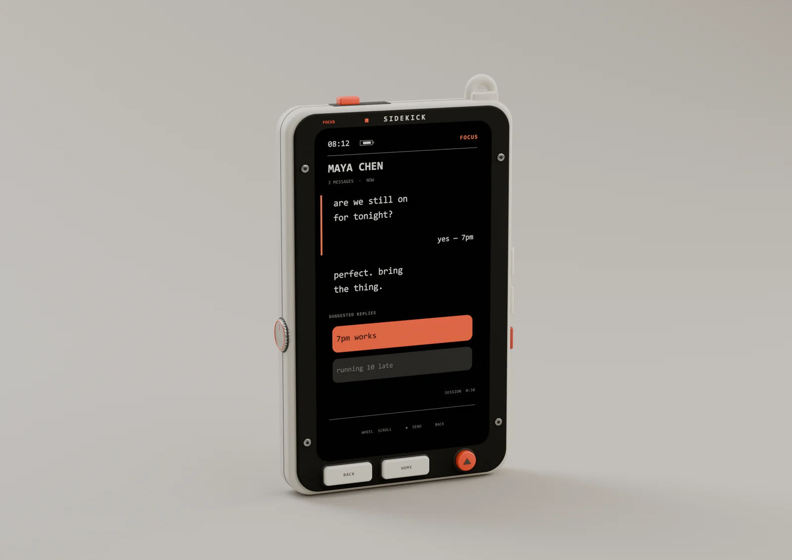

# Sidekick

A concept landing page for a 4-inch companion display designed to be put down.

Live site: [https://sidekick-ashen.vercel.app](https://sidekick-ashen.vercel.app)



Sidekick handles messages, call control, reading, music, and navigation while the phone stays in your pocket. The page is built around the real industrial-design model: a React Three Fiber hero, interactive finish switching, a scroll-linked ninety-second window, an anatomy explorer, and the published refusal list.

## Stack

- React 19 + TypeScript + Vite
- Tailwind CSS v4
- Motion
- React Three Fiber / drei
- Blender and Cycles for the product model and renders

## Repository

```
web/                 Vite landing page
  public/models/     sidekick.glb exported from the Blender source
  public/renders/    optimized web image plates
  src/components/    page sections and the 3D stage
design/              Blender source, build script, full-resolution renders
docs/                concept, product brief, and PRD
tools/               GLB export and web image scripts
```

## Run locally

```bash
cd web
npm install
npm run dev
```

Production build:

```bash
cd web
npm run build
npm run preview
```

## Rebuild the product assets

```bash
# Interactive GLB
blender -b design/sidekick.blend --python tools/export_glb.py

# Web image plates and social card
python tools/make_web_images.py
```

Both scripts write into `web/public`, so the site never depends on a third-party image host.

## Deployment

The root `vercel.json` builds the `web` app and publishes `web/dist`:

```bash
vercel --prod
```

The site is a single page, so no SPA rewrites are required. Vercel serves the GLB and image plates from the same origin.

## Status

Concept 01, 2026. Not for production. Specifications on the page are targets from the product brief, not validated manufacturing claims.
